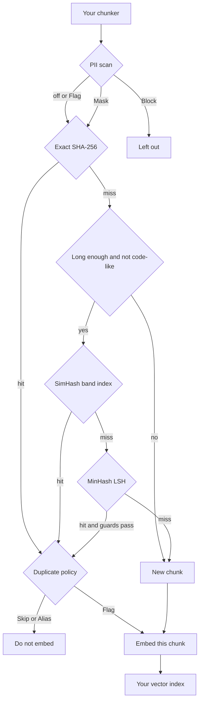
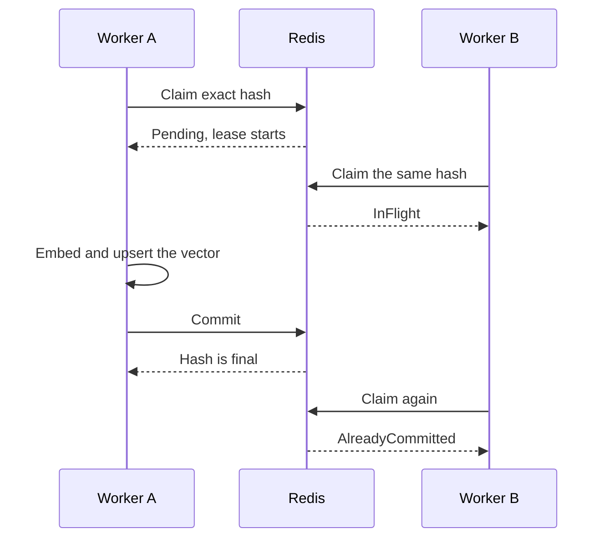

# How Rechunk works

## The gap

A typical RAG ingest splits a document, embeds every piece, and upserts the vectors. Four things then go wrong. The chunker only splits. The vector store only stores. Neither looks at a chunk before you pay to embed it.

**The same document is embedded again.** The next ingest sends every chunk, including text that did not change, and the old vectors are often left in the index. Rechunk keeps a manifest of the chunks in each document. Unchanged text is not embedded, including a paragraph that only moved. New and edited chunks go through the normal pipeline. A chunk is deleted from the index when no document uses it any more.

**Near copies are stored as their own vectors.** A repeated footer, a copied page, or a small edit costs another embedding and shows up again in search. The exact stage hashes the cleaned text with SHA-256. SimHash and MinHash, both off until you turn them on, catch text that is close but not the same. Guards keep two chunks apart when a number or a "not" changed, or when the only change is an identifier.

On 2500 of 13555 files from [dotnet/docs](https://github.com/dotnet/docs) at commit `82937f4` the default pipeline (SimHash distance 3, MinHash 0.85, guards on) saw 54085 chunks and skipped 11675 embeds, 21.6%: 11610 exact, 21 SimHash, 44 MinHash. That sweep row took 1136 ms, 47610 chunks per second. A hand check of 20 of the 65 near pairs called 16 true duplicates. That is not a score of every near pair. Before the short chunk, code, and identifier guards, the same sample skipped 11873 (22.0%: 11610 exact, 117 SimHash, 146 MinHash), and a hand check of 10 of 263 near pairs called 4 true duplicates. The settings and the pair notes are in [benchmarks/dotnet-docs.md](benchmarks/dotnet-docs.md).

On the PAWS wiki labeled final test split (8000 pairs) the same defaults merged 41 pairs, 34 labeled paraphrases and 7 not. Precision 82.9% is 34 of 41. Recall 1.0% is 34 of 3536. Those paraphrases are rewordings, not near copies, so the recall stays low. 4 of the 7 wrong merges are identical strings that PAWS labels as different. The other settings are in [benchmarks/paws.md](benchmarks/paws.md). Planted edits on made up text are in [benchmarks/synthetic.md](benchmarks/synthetic.md). Neither run scores answer quality. The docs run is one English corpus.

**Stateless workers have nowhere safe to share dedup state.** Two instances both treat a chunk as new, or one marks it seen and dies before the vector is written. SQLite (one machine) or Redis (many instances) holds the exact hashes and the near indexes. A worker claims the hash first and commits only after the vector write. The claim has a lease. A chunk that keeps failing is written to the dead letter store and can be replayed. The in memory indexes know only the process they live in.

**PII, the audit trail and erasure are left to the team.** Rechunk can scan a chunk before it is fingerprinted, then flag it, mask it or block it. Every decision can be written to an audit log that stores no chunk text and no finding value. Erasure removes the vectors and the fingerprints and leaves a receipt of counts.

The rest of this page is how that works. Options and edge cases live in the linked pages.

## Where it sits

Rechunk is not a chunker. You split the document, then pass `ChunkInput` values (position, text, and an optional language tag).

It runs before the embedder and before the index. `DeduplicateAsync` only decides. `ChunkIngestor` and `RevisionTracker` call your embedder for the chunks that should be stored, then write vectors through `IVectorSink`. Text that is a duplicate, or that the PII policy blocks, is not sent to the embedder.

SimHash and MinHash are off by default. With both off, a miss on the exact hash is a new chunk, and the band and LSH steps in the chart do not run. Turn only one of them on and the other step is skipped. When both are on, a SimHash hit still has to pass MinHash confirmation unless you turn that off.

## One chunk

The text is cleaned up once and shared by every stage: Unicode NFC, any run of whitespace becomes one space, ends are trimmed. Case is kept, so "Notice" and "notice" differ at the exact stage.

**PII, if you turn it on.** It is off by default. The built in detector is a set of rules with checksums (cards, API keys, emails, phone numbers, and a few national ids). A finding is a type, a span and a confidence. The value is not kept.

| Policy | What happens |
| --- | --- |
| Flag (default) | The finding is recorded. The chunk continues as it is. |
| Mask | The span is replaced with a placeholder such as `[EMAIL]` before any hash is computed. |
| Block | The chunk is not fingerprinted, claimed, embedded or stored. |

When one chunk has findings with different policies, the strictest wins. One Block finding stops the chunk. A scan that throws fails closed: the chunk is dead lettered and not treated as clean. Names and free text addresses need a detector you plug in (`IPiiDetector`). Details are in [pii.md](pii.md).

**Exact hash.** SHA-256 of the cleaned text. The chunk id is that hash in hex. A language tag, when the chunk has one, is appended to the id. This stage always runs. A hit never reaches SimHash or MinHash.

**SimHash.** A 64 bit fingerprint over word shingles (3 words by default). The index splits the hash into `MaxHammingDistance + 1` bands, 4 bands at the default distance of 3, and only compares chunks that share a band. Two chunks match when the Hamming distance is within that limit. It is quick and rough: one changed word in a long chunk can be 2 bits away, and in a short chunk 5 bits or more.

**MinHash.** A signature of 128 numbers, from the same kind of shingles, stable across platforms. The estimate of Jaccard similarity is the share of equal slots, so with 128 slots it is off by about 0.04 either way. Locality sensitive hashing keeps only pairs that share a whole band. At the default threshold of 0.85 that is 9 bands of 14 rows. A pair at similarity s is a candidate with probability 1 - (1 - s^14)^9. Every candidate is checked with the real estimate, so the index can miss a pair and does not accept one the estimate rejects.

When both near stages are on, MinHash confirms a SimHash hit (`ConfirmWithMinHash`, the default). It also runs on its own for close pairs SimHash missed. You can turn confirmation off and trust SimHash. The builder calls, and the point where the LSH curve is steepest, are in [stages.md](stages.md).

**Guards.** These apply only to the near stages. The exact stage still runs.

- Fewer than 20 tokens (`NearDuplicateMinTokens`): no SimHash and no MinHash. In Chinese, Japanese or Thai each character counts as a token. `SimHash.MinWords` and `MinHash.MinWords` (8) still apply if you lower the token floor.
- Code, an include directive, or the same kind of markup (`SkipCodeLikeChunks`, on by default) is skipped by the near stages.
- A different number or a negation (`GuardNumbersAndNegations`) keeps the two chunks apart. "30 days" and "60 days" are not merged.
- If the ordinary words match and the only tokens that differ look like identifiers (`GuardIdentifierOnlyChanges`), the pair is kept apart. That covers an API name, a snippet id, CamelCase, or a dotted name.

A chunk that is skipped as a near duplicate is not added to the near indexes. The chunk it matched stands for it. A chain of small edits (A, then B close to A, then C close to B but not to A) is not followed.

## A hit and a miss

`OnDuplicate` decides what a hit means. The default is Alias.

| Outcome | When |
| --- | --- |
| Duplicate | Skip or Alias. The chunk is not embedded. `DuplicateOf` is the chunk it matched. Alias remembers this text next to that chunk. Skip does not. |
| Flagged | The policy is Flag. The chunk is embedded under its own id, and the report says what it matched. |
| Unique | No stage matched. Send it to the embedder. |
| InFlight | Another worker holds this exact text and the lease has not ended. Do not embed it. Come back later. |
| Blocked | A PII Block finding. The id is empty. Nothing is stored. |

On a near hit the decision also carries the stage, the SimHash distance when there is one, and the Jaccard estimate when MinHash looked at the pair.

On a miss the chunk is remembered under its own id. With the in memory indexes that happens as soon as the decision is made, which is before your code writes the vector. A crash in between can leave the text marked as seen with no vector. The shared store stays pending until you commit, and commit is after the vector write. Until that commit, other workers do not treat it as a near duplicate. Exact repeats are settled by the claim, including across workers, so only one of them embeds.

A skipped near duplicate still records an exact row that points at the chunk it matched, so the same text is an exact hit the next time. Inside one batch, a near duplicate of a chunk that is still pending waits on that chunk. It is committed after the first commit, and released if the first one failed, so it never points at a chunk that has no vector. A second copy of the exact same text in that batch is a duplicate at once.

Dry run reports the same decisions and writes nothing.

## Revisions

Send the whole new version of a document through `RevisionTracker`. It compares chunks with the manifest it has stored.

- **Keep.** The text is already in the document, in the same place or a new one. The vector stays. A moved paragraph is not embedded. The new position is recorded.
- **Embed.** The text is new. It goes through claim, embed, write and commit, so a copy of a chunk from another document is still skipped.
- **Replace.** New text sits where an old chunk was. It is embedded, and the manifest records which chunk it replaced.
- **Delete.** The old chunk is gone from this document. Its vector and its fingerprints are removed once no document uses it. A footer that two documents share stays until both let go.

The default revision policy is `ReEmbedChanged`. An edited paragraph is embedded again and is not matched against the old chunk it replaces, so the old vector cannot stand in for the new wording. `ReuseForSmallEdits` allows a small edit to alias the old chunk and skip the embedding. The vector then still describes the old wording.

The write order is deliberate. New vectors are written first, the document switches to the new revision second (a compare and swap on the revision number), and old vectors are deleted last. A crash in the middle leaves work the next run can finish. The same chunks in the same order come back as `Unchanged` and write nothing.

The manifest stores ids, positions and languages. It does not store chunk text. More, including the status values and `VerifyAsync`, is in [revisions.md](revisions.md).

## Scopes and vector ids

A scope is a string you choose, often a tenant. The default is `"default"`. Dedup never matches across scopes.

The language tag is part of the scope the indexes and the claims use, so a French chunk is only compared with French chunks. An untagged chunk is only compared with untagged chunks. The chunk id stays plain hex when there is no tag. A tag is appended, as in `3fa9...c1.fr`.

The id comes from the text and the language. The same text with the same language in two scopes has the same id, and the vector has to be stored under both. `VectorDataMapping.ScopedKey` builds `scope:id`. The VectorData sink refuses a key that leaves the scope out, because a delete in one scope would remove the other. Vectors already stored under the bare chunk id need a new key or a fresh ingest.

Erasure and deletes are scoped the same way. Another scope is not touched.

## Workers sharing a store

The in memory indexes are the default, and they are private to one process. For queue triggered workers, use a shared store so every instance checks the same exact hashes, SimHash bands and MinHash bands.

1. **Claim.** The hash is stored as pending, with a lease and a holder (the queue message id is a good holder). One winner when many workers claim the same hash.
2. **Write.** The winner embeds the chunk and upserts the vector.
3. **Commit.** The hash is final and the near indexes learn the chunk. Commit is safe to call twice.
4. **Release.** On failure the pending row is removed. The chunk is not left marked as seen.

A holder that asks again for the same chunk gets the claim back (`Renewed`). If the lease ran out, another worker can take it over. A worker that lost the lease and tries to commit gets `NotHeld` when someone else owns it. If nobody took it, the original holder can still commit.

`ChunkIngestor` runs that sequence with retries. After `Failures.MaxAttempts` (3) the chunk goes to the dead letter store: id, scope, document, position, the stage that failed, a short reason, the attempt count and the time. Chunk text is left out unless `Failures.StoreTextInDeadLetters` is on. `ReplayAsync` runs the matching records again. A record with no stored text needs a callback that loads it from your source.

The lease does not renew itself. Set `Store.LeaseDuration` longer than the slowest embed plus the vector write. Five minutes is the default. Clocks are the workers' clocks, so keep the lease much longer than any skew.

Near stages only see committed chunks. Two near duplicates in flight on different workers can both be embedded. An exact repeat is claimed once, so only one worker embeds it.

SQLite is one writer at a time on one file, which is enough for one machine. Redis (5 or newer) is the one to use when instances come and go. Keys for one scope share a hash tag. It has been tested on a single Redis, not on a cluster. The full lifecycle, the queue sample, and the limits are in [shared-store.md](shared-store.md).

## Languages

Set `Language` on the chunk, or turn on `Language.AutoDetect`. The built in detector is script first, then a few function words for Latin text. It returns nothing when it is not sure, and the chunk stays untagged. Untagged chunks match each other, which is how data ingested before tagging still behaves.

Text in Han, kana, Thai, Lao, Khmer or Myanmar is cut into characters for SimHash and MinHash, because those scripts often have no spaces. Word shingles are unchanged for Latin and the other spaced scripts.

Starting to tag changes ids. The same text under `fr` is a different chunk from the untagged one, and it is embedded again the first time. Details, the detector's mistakes, and the options are in [languages.md](languages.md).

## Audit

The audit log is on by default. One event per chunk: new, skipped, aliased, flagged, blocked, revised, deleted, erased, dead lettered, plus one receipt per erase request.

An event has the chunk id, document, revision, source, scope, language, stage, embedding model, a short reason, who caused it, the time, and the related chunk when there is one. A PII finding is stored as a type and a span, for example a card at characters 120 to 139. The matched value is not stored. The chunk text is not stored.

The chunk id is still the SHA-256 of the cleaned text. Anyone who has that text can compute the id and look for it. Treat the log with the same care as the fingerprint store.

A failed audit write is retried, then parked in an outbox, and sent again at the start of the next revision, erase or sweep. Queries filter by document, chunk, source, scope, kind, finding type and time. There is no lookup by the text of a chunk. See [audit.md](audit.md).

## Erasure

`EraseAsync` removes what Rechunk stored for a document or a source: vectors, revision rows, fingerprints in all three stages, and dead letters. A chunk that another document in the same scope still uses is left alone. The call writes an `ErasureReceipt` with counts (documents, chunks, vectors, state rows), who asked, and the reason you passed in. It does not write the content. Do not put personal data in the reason. Use a ticket id.

You can also erase by the exact text (masking is applied the same way as ingest, so the masked form is what gets found), by chunk id, and by a PII type recorded in the audit log. A near text match is optional and can hit more than you expect. Look first.

Erasing does not touch your source documents, the chunker's output, or the embedding provider. It does not delete audit events. The steps and the half finished case are in [erasure.md](erasure.md).

## Status

Version 0.1.0 is the first set of packages. They are not on NuGet until a release tag is published, and the API can still change.

What works today:

- cleaning up text and the exact hash stage (SHA-256), with duplicate detection per scope
- the SimHash stage (off by default): a 64 bit fingerprint over word shingles and an in memory index that finds chunks within a few bits of each other, per scope and safe to use from several threads
- the MinHash stage (off by default): a signature of 128 numbers per chunk (word shingles, seeded stable hashing, same values on every platform) and an in memory LSH index that finds chunks whose estimated Jaccard similarity is at or above the threshold (0.85 by default), per scope and safe to use from several threads
- all three stages working together in one pipeline. A chunk that matches an earlier stage never reaches the later ones. When SimHash and MinHash are both on, MinHash confirms what SimHash finds (you can turn that off and trust SimHash), and it also catches looser near duplicates that SimHash misses
- a guard that keeps two chunks apart when their numbers or "not" style words differ, so "30 days" and "60 days" are not merged, and another that does the same when the only difference is an identifier (an API name, a snippet id, CamelCase, a dotted name)
- every decision records the stage that matched, which chunk it is a duplicate of, the SimHash distance and the Jaccard estimate
- a small pipeline builder, DI setup, dry run mode
- a shared fingerprint store, so many stateless workers check against the same exact hash, SimHash and MinHash indexes. A chunk is claimed first, committed after its vector is written and released if the work fails, so a failed chunk is never left marked as seen. The in memory indexes are still the default, and there are SQLite and Redis backends (see [shared-store.md](shared-store.md))
- an ingestor that runs claim, embed, vector write and commit with retries, and writes a dead letter (no chunk text unless you ask for it) when a chunk keeps failing, with list and replay
- revision tracking and clean deletes: a new version of a document only embeds the chunks that changed, keeps moved paragraphs as they are, and removes the vectors and fingerprints of chunks that are gone, safely with many workers (see [revisions.md](revisions.md))
- a language tag per chunk, so chunks in different languages are never merged, and character shingles for Chinese, Japanese and Thai, so near duplicates are found in text without spaces (see [languages.md](languages.md))
- a persistent audit trail (in memory, SQLite and Redis, one contract test suite for all three): one event per chunk for new, skipped, aliased, flagged, revised, deleted, erased and dead lettered, with document, revision, stage, scope, language and time, never the chunk text. Queries by document, chunk, source and time range. A failed audit write is retried and then parked in an outbox, so it is not lost (see [audit.md](audit.md))
- PII and secret scanning before dedup and embedding: a built in detector for cards (Luhn), API keys, emails, phone numbers, Aadhaar (Verhoeff), PAN, SSN and IBAN, a policy per type (Flag, Mask or Block), masking before the chunk is fingerprinted, and an interface for Presidio or Azure AI Language (see [pii.md](pii.md))
- erasure by document, by source, by text, by chunk and by finding, which removes the vectors, the chunks and every fingerprint, and leaves a receipt that has counts and no content (see [erasure.md](erasure.md))
- a writer for any Microsoft.Extensions.VectorData collection, with batching, retries and the scoped delete that revisions use
- the interfaces for the rest

What is still unfinished:

- the Microsoft.Extensions.AI wrapper only forwards each call to the inner generator, so that package is not published
- the Semantic Kernel helper registers Rechunk on the kernel and does nothing more yet
- MMR reranking throws NotImplementedException

## Packages

| Package | Pick it when |
| --- | --- |
| Rechunk | Always. The pipeline, the in memory store, revisions, PII, audit. The project folder is `src/Rechunk.Core`. |
| Rechunk.Storage.Sqlite | One machine, and the fingerprints, dead letters, revisions and audit log should survive a restart. |
| Rechunk.Storage.Redis | Many stateless workers should share that same state. |
| Rechunk.Extensions.VectorData | Vectors live in a `Microsoft.Extensions.VectorData` collection and you want batched upserts, retries, and the scoped delete revisions use. |
| Rechunk.Extensions.AI | You want a wrapper over `IEmbeddingGenerator`. Today it forwards every text to the inner generator. It does not skip duplicates yet. |
| Rechunk.SemanticKernel | You want Rechunk registered on a Semantic Kernel builder. That registration is all it does today. |

There is no SQL Server package. `sqlserver-schema.sql` is a sketch of the tables and has not been run against a server.

## Limits

These match the current code.

- Short chunks are a poor fit for the near stages. Under 20 tokens only the exact hash runs. On the dotnet/docs sample, near pairs under that length were headings, boilerplate and short parameter lines, and one substituted word often changed the meaning. SimHash on a short chunk moves by several bits for a one word edit. MinHash is aimed at "about 90 percent the same", not at a call that sits on the 0.85 line. PAWS recall at the defaults is 1.0% (34 of 3536 paraphrases). Those pairs are rewordings, not near copies, so most are not close enough to merge.
- A skipped near duplicate is not inserted into the near indexes, so a chain of small edits stops at the first stored chunk.
- Two workers that see near duplicates of each other at the same time can both embed. An exact repeat is claimed once. The claim lease does not renew while the embedder is still running.
- Masking runs before the hash. The chunk id is the hash of the masked text, and two chunks that differ only by an email become one. Turning masking on does not rewrite chunks already stored. The next revision sees the masked form as new text.
- Adding a language tag changes the chunk id. Old untagged rows stay untagged until you ingest them again. Until then they only match other untagged chunks.
- The built in PII rules miss names, street addresses, and numbers that have no checksum and no context word. Data already in the index is not scanned when you enable the scan.
- The audit log stores no values. It does store the chunk id, which is a hash of the text. With the in memory log, or with events still in the outbox, a query is missing rows. A process that dies after the revision commits and before the audit write leaves a gap in the trail. The vectors are still correct.
- `Rechunk.Extensions.AI` forwards every text to the inner generator. `Rechunk.SemanticKernel` only registers the core services. Dedup is the pipeline above, not those two packages.

## Planned

- MMR style diversity when retrieving
- a benchmark on a public document set that checks embedding calls saved against answer quality
- a Microsoft.Extensions.AI wrapper that skips text already embedded
